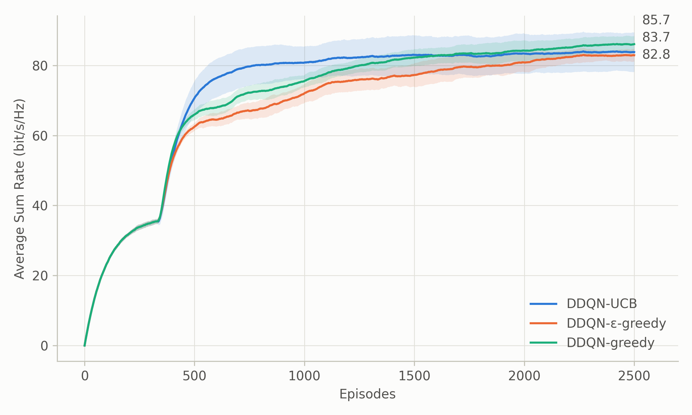
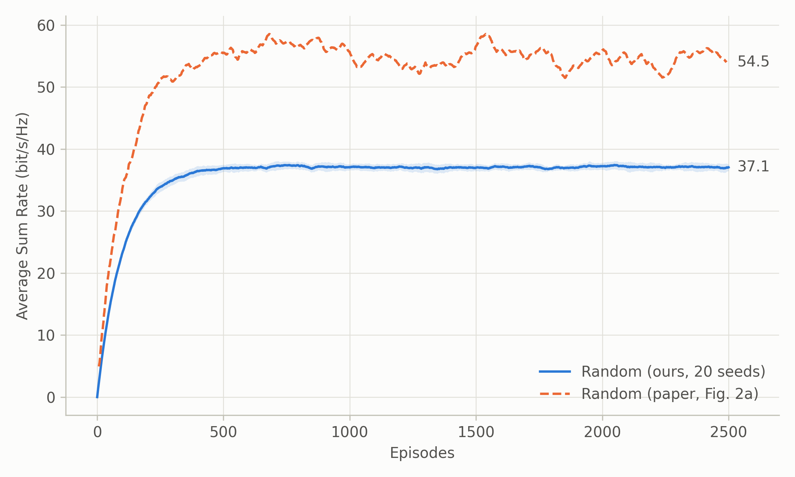

# SWIPT-EH CIoT: DDQN-UCB for joint time and power management

A PyTorch reproduction of

> N. Abdolkhani, N. Abdel Khalek, W. Hamouda and I. Dayoub, "Deep Reinforcement Learning for Joint Time and Power Management in SWIPT-EH CIoT," *IEEE Communications Letters*, vol. 29, no. 4, pp. 660–664, Apr. 2025. doi: [10.1109/LCOMM.2025.3536182](https://doi.org/10.1109/LCOMM.2025.3536182)

A cognitive IoT (CIoT) transmitter shares a channel with a primary user (underlay) and powers itself by energy harvesting (SWIPT-EH). In every time slot it picks a time-switching factor ρ (the fraction of the slot spent harvesting) and a transmit power P_s. The goal is to maximise the sum rate without exceeding the interference threshold at the primary receiver or draining the battery. The agent is a double deep Q-network with upper-confidence-bound exploration (DDQN-UCB). It is compared against ε-greedy, greedy and random action selection.

## Files

| File | Contents |
| --- | --- |
| `config.py` | All hyperparameters, taken from Sec. IV of the paper |
| `env.py` | `SwiptCIoTEnv`, a Gymnasium environment (system model of Sec. II and reward of eq. (4)) |
| `agent.py` | `DDQNUCBAgent`: Q-network, replay buffer, and UCB / ε-greedy / greedy / random exploration (eqs. (5)–(7), Algorithm 1) |
| `train.py` | Trains one run and saves `metrics.csv`, the model `ddqn_ucb.pt` and a plot `asr.png` |
| `plot_seeds.py` | Compares groups of runs (one group per strategy or setting, several seeds each) |
| `plot_random_vs_paper.py` | Compares the Random strategy with the Random curve digitised from Fig. 2a of the paper |

## Setup

Requires Python 3.10+.

```bash
pip install -r requirements.txt
```

## Training

```bash
python train.py --explore ucb --seed 0 --out results/ucb/seed0
```

| Flag | Default | Meaning |
| --- | --- | --- |
| `--explore` | `ucb` | `ucb` (proposed), `egreedy`, `greedy` or `random` |
| `--episodes` | 2500 | number of training episodes |
| `--buffer` | 10000 | replay buffer size |
| `--B0` | 0.0 | initial battery (0.5 = B_max) |
| `--tau` | 1.0 | slot duration (s) |
| `--T`, `--L` | 30, 18 | slots per episode, slots occupied by the primary user |
| `--seed` | 0 | random seed |
| `--out` | `results` | output directory |

To train 20 seeds of one strategy:

```bash
for s in $(seq 0 19); do python train.py --explore ucb --seed $s --out results/ucb/seed$s; done
```

In PowerShell:

```powershell
foreach ($s in 0..19) { python train.py --explore ucb --seed $s --out results/ucb/seed$s }
```

## Plotting

`--group` takes a label followed by that group's run directories. Repeat it once per group:

```bash
python plot_seeds.py \
  --group DDQN-UCB      results/ucb/seed*/ \
  --group DDQN-ε-greedy results/egreedy/seed*/ \
  --out results/compare --ema 0.99
```

This writes `results/compare_seeds.png` (one panel per group) and `results/compare_mean.png` (the mean of each group over its seeds). Run `python plot_seeds.py -h` for all options.

`plot_random_vs_paper.py` reads the paper's Fig. 2 directly from the PDF. The paper is not included in this repository. To run the script, download the paper, save it as `docs/paper.pdf` and train the 20 Random runs into `results/random/seed0` … `results/random/seed19`.

## Results

All curves show the mean over 20 seeds. They are smoothed with a zero-initialised EMA to match the paper's figures.

**Exploration strategies.** UCB converges fastest and reaches about 80 bit/s/Hz by episode 800. After 2500 episodes, all three strategies end within 3 bit/s/Hz of each other.



**Random strategy vs. the paper.** Our Random baseline settles at about 37 bit/s/Hz, below the paper's curve, which settles at about 55 bit/s/Hz.



More figures are in [`results/`](results). Files ending in `_mean.png` show the mean over seeds. Files ending in `_seeds.png` show every seed. Files with `ema` in the name are smoothed with an EMA, and the others with a moving average.

- `compare_3strategies_*`: UCB vs. ε-greedy vs. greedy
- `compare_explore_*`: UCB vs. ε-greedy
- `compare_buffer_*`: replay buffer size κ = 333 vs. 10000
- `ddqn_ucb_*`: DDQN-UCB only
- `random_*`: the Random strategy against the paper

The per-seed outputs (`metrics.csv`, model checkpoints, logs) are not in the repository. Regenerate them with `train.py`.

## Differences from the paper

The paper leaves some details out. These are the choices made here (see the comments in `config.py` and `env.py`):

- **Replay buffer:** 10000 by default. The paper's κ = 333 is unstable across seeds (see `compare_buffer_*`).
- **Initial battery:** B0 = 0. The paper does not state it for Fig. 2a.
- **ε-greedy schedule:** ε = max(0.01, 0.995^episode). The paper does not give its schedule.
- **Primary user slots:** the L busy slots are drawn at random in each episode.
- **Channel gains:** exponential with mean d^α. With this reading, the sum-rate scale matches Fig. 2a/2b.
